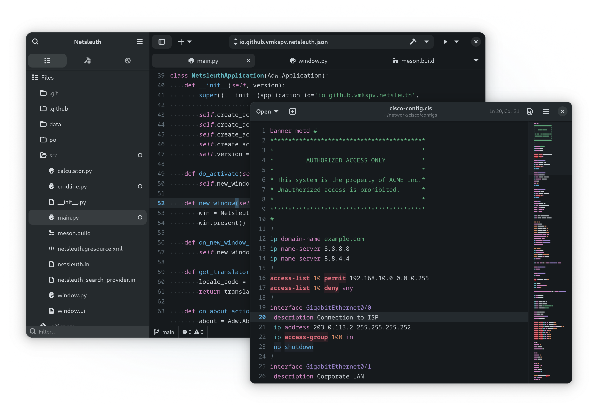

<div align="center">
  
  <h1>Zenith Theme for GtkSourceView</h1>
  <p>
    <strong>A refined dark theme with cohesive colors and complete UI coverage</strong>
    <br>
    <i>This is a GTK adaptation of the <a href="https://marketplace.visualstudio.com/items?itemName=britown.vscode-theme-zenith">Zenith</a> VS Code theme.</i>
    
  </p>
</div>

## Overview

Zenith is a refined dark theme that offers cohesive colors and comprehensive syntax highlighting support for GTK-based text editors using [GtkSourceView 5](https://wiki.gnome.org/Projects/GtkSourceView). The theme providing optimal readability with balanced contrast and semantic color assignments, making it great for long coding sessions.

The repository contains:

1. A GtkSourceView 5 theme ([zenith.xml](gtksourceview-5/styles/zenith.xml)) with a carefully curated color palette.
2. A color palette for [Ptyxis](https://gitlab.gnome.org/chergert/ptyxis) terminal ([zenith.palette](org.gnome.Ptyxis/palettes/zenith.palette)) that matches the theme’s color scheme.

## Installation

You can install the Zenith theme using a script:

```bash
curl -fsSL https://raw.githubusercontent.com/vmkspv/zenith-theme-gtk/main/install.sh | bash -s -- --full
```

### Script options

Use the `--theme` or `--ptyxis` flags to install only required components:

```bash
# Install the Zenith theme only
curl -fsSL https://raw.githubusercontent.com/vmkspv/zenith-theme-gtk/main/install.sh | bash -s -- --theme

# Install the color palette for Ptyxis only
curl -fsSL https://raw.githubusercontent.com/vmkspv/zenith-theme-gtk/main/install.sh | bash -s -- --ptyxis
```

## Contributing

Contributions are welcome!

If you have an idea, bug report or something else, don’t hesitate to [open an issue](https://github.com/vmkspv/zenith-theme-gtk/issues).

> This project follows the [GNOME Code of Conduct](https://conduct.gnome.org).

## License

Zenith Theme for GtkSourceView is released under the [MIT License](LICENSE).

The color scheme is adapted from the [Zenith Theme for VS Code](https://github.com/bkuzmanoski/vscode-theme-zenith) by Brian Kuzmanoski.
